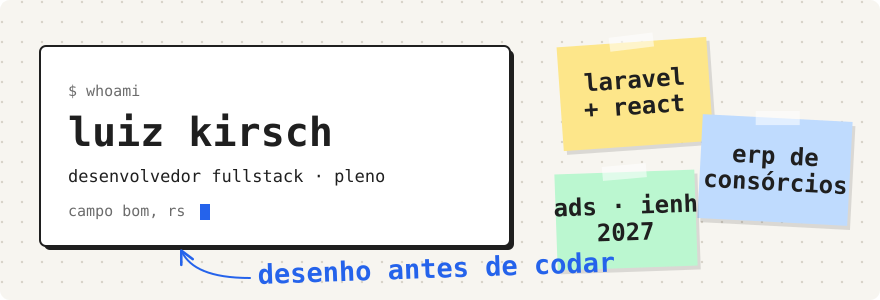
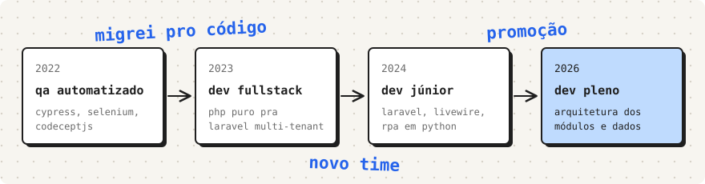
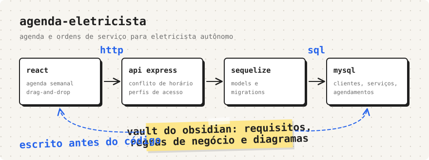
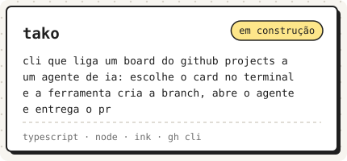
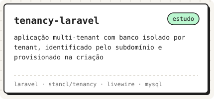
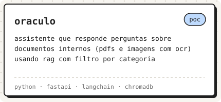
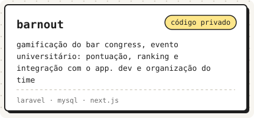
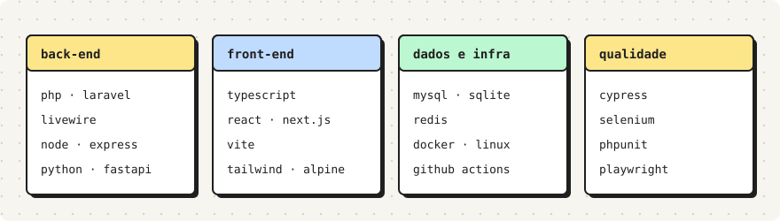

<picture>
  <source media="(prefers-color-scheme: dark)" srcset="assets/header-dark.svg">
  
</picture>

Oi, sou o Luiz. Trabalho como desenvolvedor pleno num ERP para o setor de consórcios, em Laravel e Livewire, e também em projetos com Node.js e React.

Comecei em 2022 automatizando testes com Cypress, Selenium e CodeceptJS, e em 2023 passei para o desenvolvimento. Ficou o hábito de entender o problema primeiro: requisitos, regras de negócio e modelagem no papel antes da primeira linha de código.

**[Portfólio](https://luizkirsch.github.io/portfolio/)** &nbsp;·&nbsp; **[LinkedIn](https://www.linkedin.com/in/luiz-kirsch/)** &nbsp;·&nbsp; **[E-mail](mailto:luizhkirch@gmail.com)**

 

<picture>
  <source media="(prefers-color-scheme: dark)" srcset="assets/trajetoria-dark.svg">
  
</picture>

### Em destaque

<a href="https://github.com/LuizKirsch/agenda-eletrecista">
  <picture>
    <source media="(prefers-color-scheme: dark)" srcset="assets/agenda-dark.svg">
    
  </picture>
</a>

Um sistema de agenda e ordens de serviço para um eletricista autônomo. Antes de abrir o editor, levantei requisitos, regras de negócio e diagramas num **[vault do Obsidian](https://github.com/LuizKirsch/agenda-eletrecista-obsidian)**, que fica público junto com o código.

### Outros projetos

  <a href="https://github.com/LuizKirsch/tako"><picture><source media="(prefers-color-scheme: dark)" srcset="assets/tile-tako-dark.svg"></picture></a>
  <a href="https://github.com/LuizKirsch/tenancy-laravel"><picture><source media="(prefers-color-scheme: dark)" srcset="assets/tile-tenancy-dark.svg"></picture></a>

  <a href="https://github.com/LuizKirsch/oraculo"><picture><source media="(prefers-color-scheme: dark)" srcset="assets/tile-oraculo-dark.svg"></picture></a>
  <a href="https://barnout.barcongress.com.br/"><picture><source media="(prefers-color-scheme: dark)" srcset="assets/tile-barnout-dark.svg"></picture></a>

### Com o que eu trabalho

<picture>
  <source media="(prefers-color-scheme: dark)" srcset="assets/stack-dark.svg">
  
</picture>

Campo Bom, RS &nbsp;·&nbsp; ADS na IENH &nbsp;·&nbsp; os gráficos são SVGs no mesmo estilo de quadro do meu <a href="https://luizkirsch.github.io/portfolio/">portfólio</a>, gerados por <a href="scripts/generate.py">um script Python</a>

